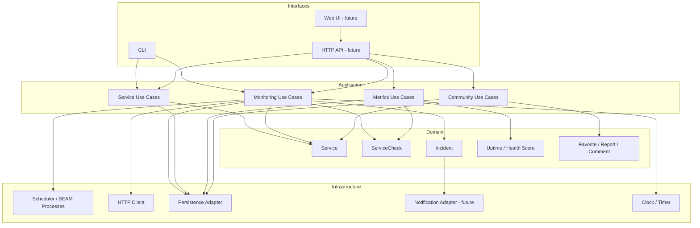

# Component Architecture

This diagram captures responsibility boundaries rather than a frozen folder structure.

## Boundary rules

- Domain rules must not depend directly on the HTTP client or persistence engine.
- Monitoring behavior is shared by Community and Private services.
- Public/private authorization and presentation rules must not be embedded inside the low-level monitoring worker.
- Infrastructure adapters may change without rewriting core classification and metric rules.
- The architecture should start simple; additional layers should only become concrete modules when behavior justifies them.
