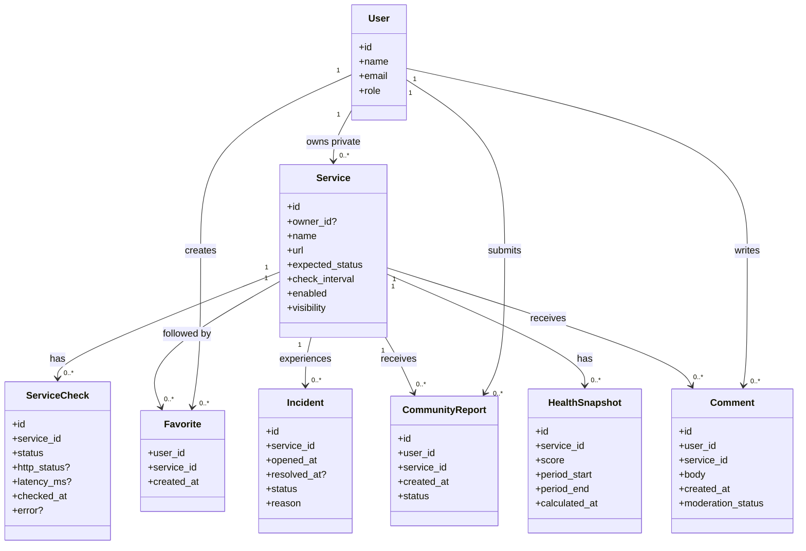

# Domain Model

The domain model focuses on concepts and relationships, not database implementation details.

## Modeling notes

- `Service` is intentionally shared by Community and Private monitoring. Visibility and optional ownership distinguish the contexts.
- Community services may have no normal user owner and are curated administratively.
- `ServiceCheck` stores the monitoring outcome because the observed result is historical evidence, not only a value to derive later.
- `Favorite`, `CommunityReport`, and `Comment` only make sense for public Community services according to current requirements.
- `HealthSnapshot` is included as a conceptual historical metric. Whether scores are persisted or reconstructed remains an implementation decision.
- Incidents are separate from individual checks because an incident may span multiple consecutive failed checks and later be resolved.
