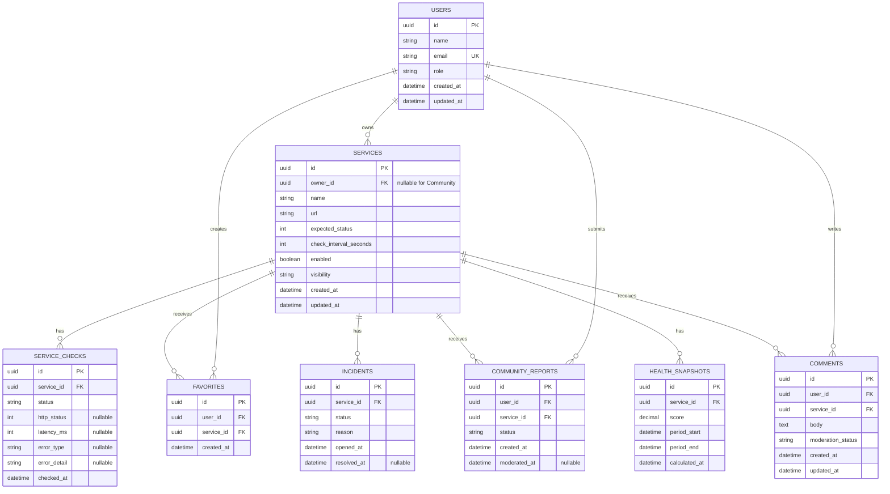

# Entity Relationship Diagram

This ERD is an initial persistence-oriented translation of the current domain. It does not select a database technology.

## Constraints to preserve later

- `USERS.email` should be unique.
- A user should not be able to favorite the same Community service twice; a unique `(user_id, service_id)` constraint is expected on `FAVORITES`.
- `SERVICES.owner_id` is nullable only because Community services can be platform-curated rather than personally owned.
- Private services must never be exposed through public queries.
- Exact ID types, column types, indexes, retention strategy, and persistence engine remain undecided.
