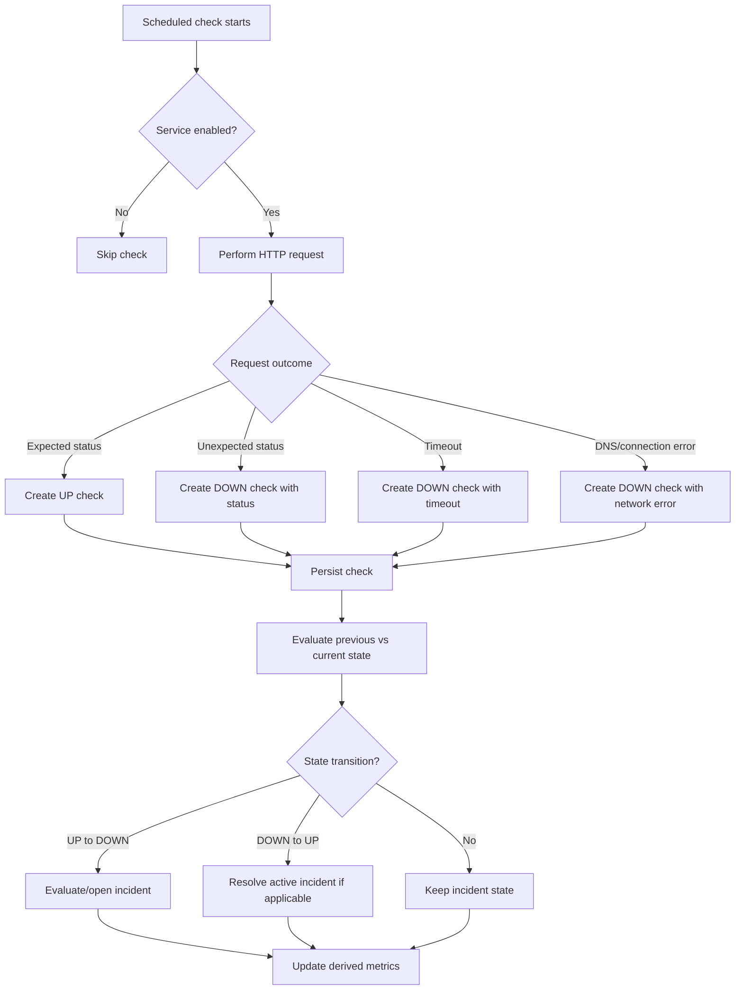
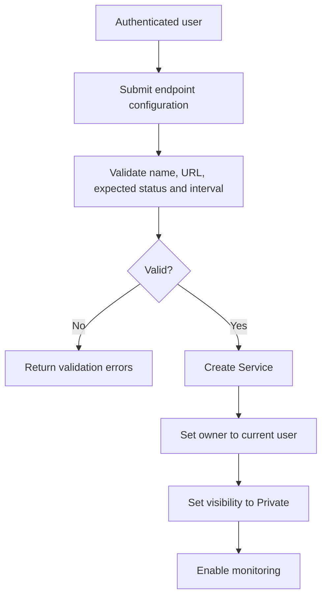
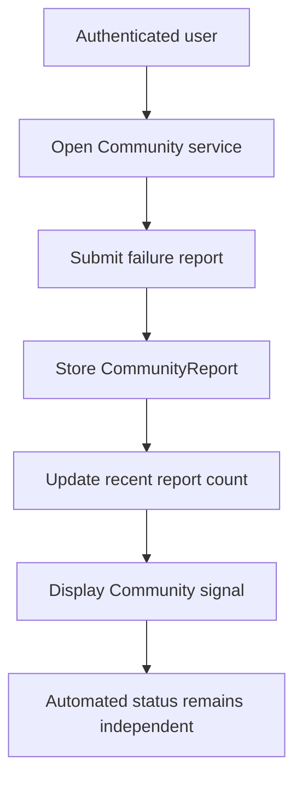
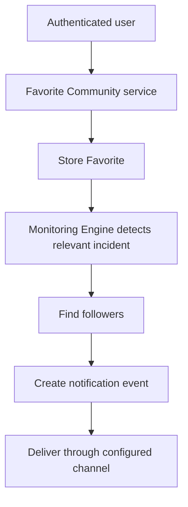

# Main Flows

## Monitoring flow

## Private endpoint creation

## Community report flow

## Favorite and alert flow

## Modeling notes

- A single failed check does not yet define the final incident policy; thresholds and consecutive-failure rules remain open decisions.
- Community reports never overwrite automated status.
- Private services are private by default and tied to their authenticated owner.
- Notification channels are intentionally abstract because providers are outside the current milestone.
