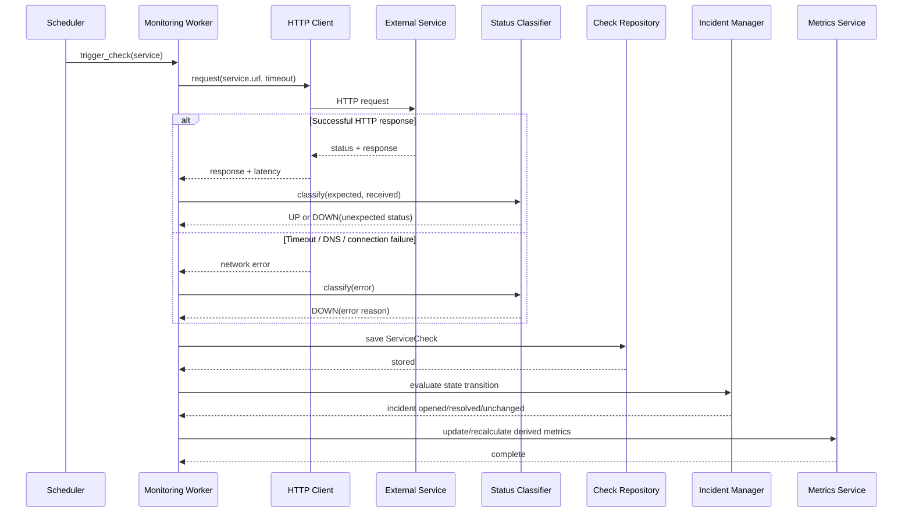

# Monitoring Check Sequence

This sequence describes the core automated monitoring path without committing to a specific scheduler, HTTP library, or database implementation.

## Design intent

- Network failures become domain results rather than crashing unrelated monitoring work.
- Classification is explicit and testable independently from the HTTP client.
- Persistence happens after the check result is constructed.
- Incident handling reacts to state transitions rather than equating one failed check with a complete incident policy.
- Metric calculation is downstream from historical monitoring data.
