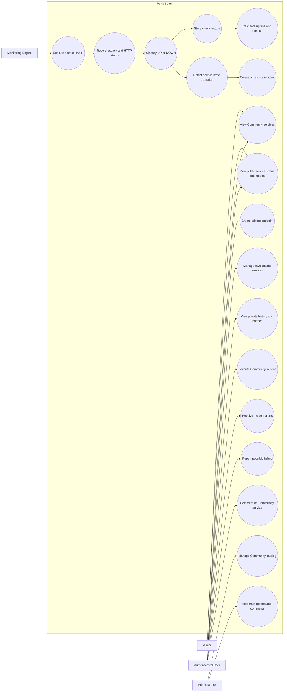

# Use Case Diagram

This diagram describes the main actors and product-level use cases currently planned for PulseBeam.

## Actors

### Visitor

An unauthenticated person accessing the public PulseBeam Community catalog.

### Authenticated User

A registered user who can use Community features and manage private endpoints through My PulseBeam.

### Administrator

An authorized user responsible for curating the Community catalog and moderating public content.

### Monitoring Engine

An internal system actor responsible for scheduled checks, classification, historical monitoring data, metrics, and incident detection.

## Important distinction

The Monitoring Engine is modeled as a system actor to make responsibilities explicit. It is not a human user and must not be confused with Community reports. Automated technical monitoring and Community perception remain independent information sources.
